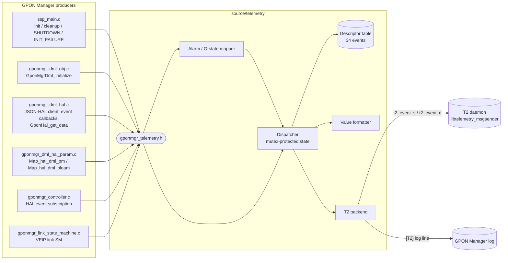
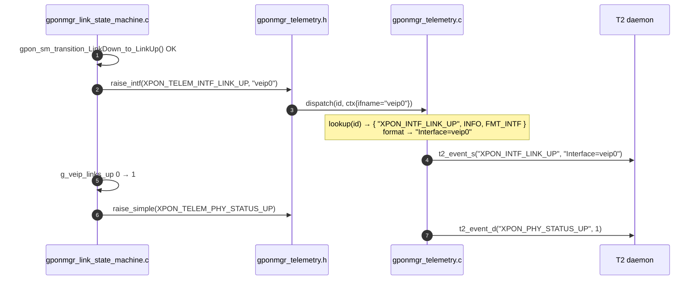
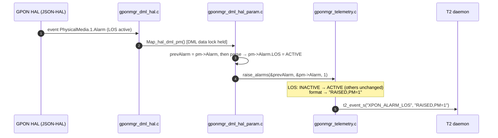
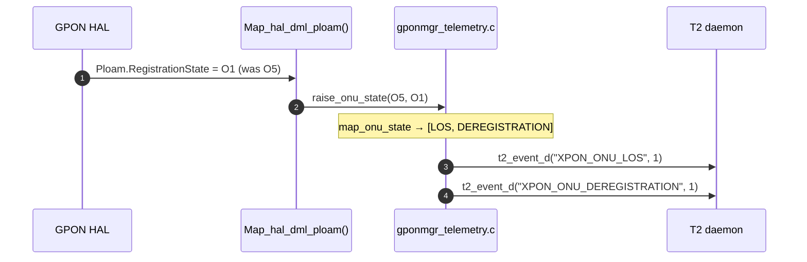
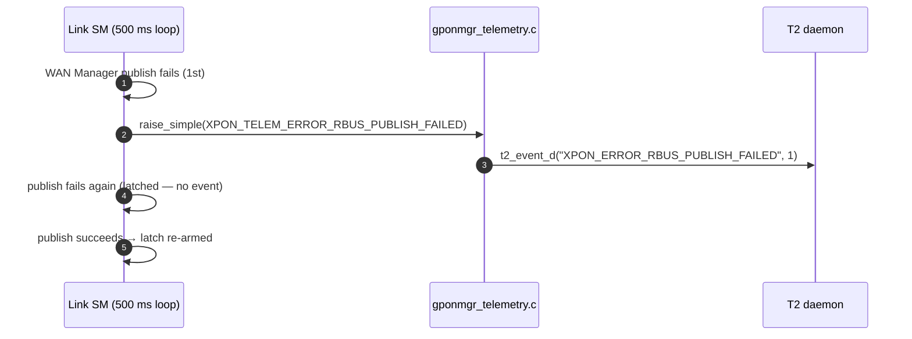
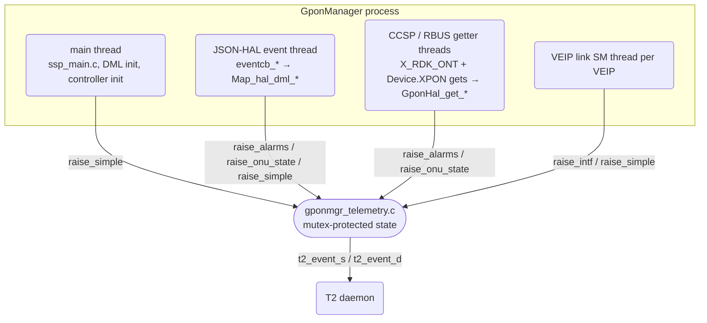
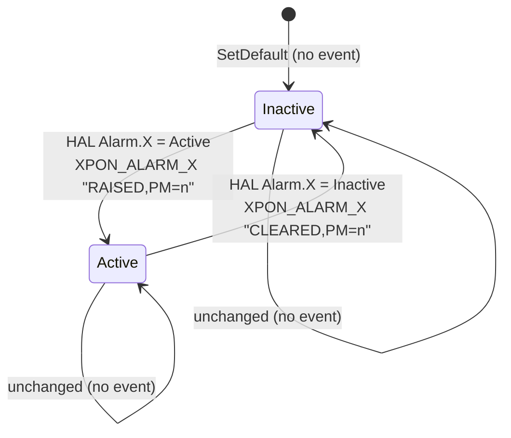
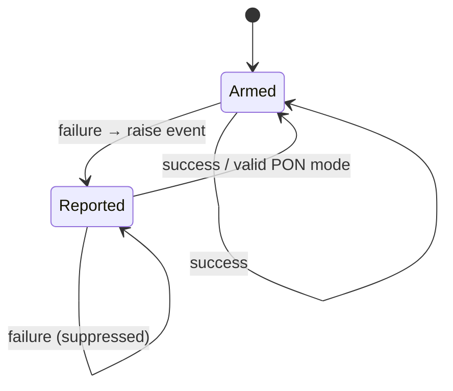

# 07 — GPON Manager Telemetry Design

**Document:** 07 | **Version:** 1.0 | **Component:** RDK GPON Manager (`rdkgponmanager`)
**Spec:** [08_TR181_Telemetry_Reference.md](08_TR181_Telemetry_Reference.md) §2 (Telemetry Events) — HTML: [08_TR181_Telemetry_Reference.html](08_TR181_Telemetry_Reference.html)
**Code:** [`source/telemetry/`](../source/telemetry/)

This document describes the T2 telemetry module of GPON Manager. It deliberately mirrors the EPON Manager design (`rdk-eponmanager/design_docs/07_Telemetry_Design.md`): same API shape, marker naming, priority model, value formats and T2 encoding. Only the GPON-specific producers (PLOAM O-states, ITU-T alarms, VEIP link state machine) differ.

---

## 1. Design Principles

| # | Principle | Description |
|---|-----------|-------------|
| 1 | Single producer surface | Callers only know event ids. Marker names, severity, value formatting, alarm/O-state mapping and T2 dispatch are hidden inside `source/telemetry/`. |
| 2 | Replaceable backend | The real `libtelemetry_msgsender` is selected at configure time only (`--enable-telemetry2-0`). Caller code never changes, and builds without T2 keep a log-only backend. |
| 3 | Independent error reporting | A T2 backend failure doesn't cascade to the producer. Telemetry hiccups are logged and suppressed. |
| 4 | Edge-triggered | Events describe *changes* (state transitions, alarm edges, first failure of a streak), never steady state, so polling loops can't flood T2. |
| 5 | Parity with EPON | Same API pattern (`xponMgr_*` ↔ `eponMgr_*`), same marker pattern (`XPON_*` ↔ `EPON_*`), same priority set, same value formats. |

---

## 2. Key Decisions

| # | Topic | Decision |
|---|-------|----------|
| 1 | Marker prefix | `XPON_` (the module covers GPON, XG-PON, XGS-PON and NG-PON2). |
| 2 | Producer API | Four entry points backed by a single `dispatch(id, ctx)`: `_raise_simple()`, `_raise_intf()` (as in EPON), plus `_raise_alarms()` and `_raise_onu_state()`, which take *prev/curr* DML snapshots and do the edge detection inside the module. |
| 3 | Alarm raised/cleared | One event id per ITU-T alarm (14). `RAISED`/`CLEARED` is encoded in the value together with the PhysicalMedia instance: `RAISED,PM=<n>`. |
| 4 | ONU status events | The 4 EPON ONU events (LOS, DOWNSTREAM_SIGNAL_DETECTED, REGISTRATION, DEREGISTRATION), derived from PLOAM O-state transitions, plus GPON-only `XPON_ONU_EMERGENCY_STOP` (O7). |
| 5 | Wrong PON mode | `XPON_SYSTEM_HAL_WRONG_PON_MODE` only when the module reports an **EPON** mode. All ITU modes (GPON / XG-PON / XGS-PON / NG-PON2) are valid. |
| 6 | Shutdown | `XPON_SYSTEM_SHUTDOWN` only on the graceful interactive `q` path in `ssp_main.c`. In daemon mode no signal handler raises it. |
| 7 | Simple-marker encoding | Events without a value use `t2_event_d(marker, 1)`, because `t2_event_s()` drops an empty string. Events with a value use `t2_event_s(marker, value)`. Identical to EPON. |
| 8 | Retry loops | Failures on repeating paths (stats polling, WAN Manager publish, PON mode) are latched: one event per failure streak. |
| 9 | Build flag | `--enable-telemetry2-0` (default **off**), giving `ENABLE_FEATURE_TELEMETRY2_0` and `-ltelemetry_msgsender`. Same flag name as EPON. |
| 10 | T2 component name | `GponManager` (EPON: `EponManager`). |

---

## 3. Public API

Header: [`source/telemetry/gponmgr_telemetry.h`](../source/telemetry/gponmgr_telemetry.h)

```c
typedef enum {
    /* §2.1 ONU activation (PLOAM) */
    XPON_TELEM_ONU_LOS, XPON_TELEM_ONU_DOWNSTREAM_SIGNAL_DETECTED,
    XPON_TELEM_ONU_REGISTRATION, XPON_TELEM_ONU_DEREGISTRATION,
    XPON_TELEM_ONU_EMERGENCY_STOP,
    /* §2.2 Interface link */
    XPON_TELEM_INTF_LINK_UP, XPON_TELEM_INTF_LINK_DOWN,
    XPON_TELEM_PHY_STATUS_UP, XPON_TELEM_PHY_STATUS_DOWN,
    /* §2.3 PhysicalMedia alarms */
    XPON_TELEM_ALARM_LOS, XPON_TELEM_ALARM_LOF, XPON_TELEM_ALARM_SF,
    XPON_TELEM_ALARM_SD, XPON_TELEM_ALARM_LCDG, XPON_TELEM_ALARM_TF,
    XPON_TELEM_ALARM_SUF, XPON_TELEM_ALARM_MEM, XPON_TELEM_ALARM_DACT,
    XPON_TELEM_ALARM_DIS, XPON_TELEM_ALARM_MIS, XPON_TELEM_ALARM_PEE,
    XPON_TELEM_ALARM_RDI, XPON_TELEM_ALARM_ROGUE,
    /* §2.4 System lifecycle */
    XPON_TELEM_SYSTEM_INIT_SUCCESS, XPON_TELEM_SYSTEM_INIT_FAILURE,
    XPON_TELEM_SYSTEM_SHUTDOWN, XPON_TELEM_SYSTEM_HAL_WRONG_PON_MODE,
    /* §2.5 Errors */
    XPON_TELEM_ERROR_HAL_CALL_FAILED, XPON_TELEM_ERROR_HAL_EVENT_SUBSCRIBE_FAILED,
    XPON_TELEM_ERROR_HAL_EVENT_PARSE_FAILED, XPON_TELEM_ERROR_STATS_COLLECTION_FAILED,
    XPON_TELEM_ERROR_RBUS_PUBLISH_FAILED, XPON_TELEM_ERROR_RBUS_REGISTER_FAILED,
    XPON_TELEM_ERROR_STATE_MACHINE_START_FAILED,

    XPON_TELEM_EVENT_ID_MAX
} xponMgr_telemetry_event_id_t;

int xponMgr_telemetry_init(const char *component_name);   /* once, at start-up */
int xponMgr_telemetry_cleanup(void);                     /* safe if not initialised */

int xponMgr_telemetry_raise_simple(xponMgr_telemetry_event_id_t id);
int xponMgr_telemetry_raise_intf(xponMgr_telemetry_event_id_t id, const char *ifname);

/* Edge-detecting helpers — raise only what changed between prev and curr. */
int xponMgr_telemetry_raise_alarms(const DML_ALARM *prev, const DML_ALARM *curr,
                                   ULONG pm_instance);            /* returns #events */
int xponMgr_telemetry_raise_onu_state(REG_STATE_ENUM prev,
                                      REG_STATE_ENUM curr);       /* returns #events */
```

| Function | EPON equivalent | Notes |
|----------|-----------------|-------|
| `xponMgr_telemetry_init` / `_cleanup` | `eponMgr_telemetry_init` / `_cleanup` | Idempotent. Calls `t2_init()` / `t2_uninit()` when T2 is enabled. |
| `xponMgr_telemetry_raise_simple` | `eponMgr_telemetry_raise_simple` | Value-less events. |
| `xponMgr_telemetry_raise_intf` | `eponMgr_telemetry_raise_intf` | `Interface=<ifname>`; NULL/empty reported as `unknown`. |
| `xponMgr_telemetry_raise_alarms` | `eponMgr_telemetry_raise_alarm` | Takes the whole `DML_ALARM` before/after instead of one HAL alarm record, because the GPON HAL reports alarm *state* rather than alarm *events*. |
| `xponMgr_telemetry_raise_onu_state` | (inside EPON `controller.c`) | GPON maps PLOAM O-states inside the module, so the mapping is unit-testable. |

---

## 4. Architecture



Build structure: `source/telemetry/` builds `libRdkGponManager_telemetry.la` (noinst), which is linked into the `GponManager` binary together with `$(T2_LIBS)`. It is listed first in `source/Makefile.am` `SUBDIRS`, so it is built before `TR-181` and `GponManager`.

---

## 5. Internal Components

Source: [`source/telemetry/gponmgr_telemetry.c`](../source/telemetry/gponmgr_telemetry.c). The section numbers match the comment banners in the file.

### 5.1 Event Descriptor Table

`k_table[XPON_TELEM_EVENT_ID_MAX]` is a designated-initialiser array that maps each id to `{ marker, priority, value-format }`, for example:

```c
[XPON_TELEM_ONU_LOS]        = { "XPON_ONU_LOS",        PRIO_CRITICAL, FMT_NONE  },
[XPON_TELEM_INTF_LINK_UP]   = { "XPON_INTF_LINK_UP",   PRIO_INFO,     FMT_INTF  },
[XPON_TELEM_ALARM_ROGUE]    = { "XPON_ALARM_ROGUE",    PRIO_CRITICAL, FMT_ALARM },
```

`lookup(id)` rejects ids that are out of range or have no entry.

### 5.2 Value Formatter

| Format | Output | Events |
|--------|--------|--------|
| `FMT_NONE` | empty | ONU, PHY status, lifecycle, errors |
| `FMT_INTF` | `Interface=<ifname>` (`unknown` if NULL/empty) | `XPON_INTF_LINK_UP/DOWN` |
| `FMT_ALARM` | `RAISED,PM=<n>` / `CLEARED,PM=<n>` | `XPON_ALARM_*` |

`<n>` is the 1-based `Device.X_RDK_ONT.PhysicalMedia.{i}` instance. EPON uses `LLID=<n>` in the same place. Formatting goes into a 256-byte stack buffer; truncation is reported as a failure.

### 5.3 DML Alarm / PLOAM State Mapper

* **Alarms:** `k_alarm_map[]` holds `{ offsetof(DML_ALARM, <field>), event id }` for the 14 alarms. `raise_alarms()` compares each field in `prev` and `curr` and dispatches only the fields that changed (`ACTIVE` → `RAISED`, `INACTIVE` → `CLEARED`).
* **ONU state:** `map_onu_state(prev, curr)` turns one O-state transition into 0–5 ONU events (§6.1). If `prev == curr`, nothing is sent or logged.

### 5.4 T2 Backend

`t2_send(marker, value, prio)`:

1. Always logs `[T2] <PRIO> <marker> [value]` through `CcspTraceInfo`. This is the only output when T2 is compiled out.
2. With `ENABLE_FEATURE_TELEMETRY2_0`: empty value → `t2_event_d(marker, 1)`; otherwise `t2_event_s(marker, value)`.
3. A non-success `T2ERROR` is logged at warning level and returns `-1` to the dispatcher. It is never propagated as a failure of the producer's own operation.

The backend matches EPON `t2_send()` line for line apart from the logging macro.

### 5.5 Dispatcher

`dispatch(id, ctx)`: `lookup` → check `initialized` under `g_state.mtx` → `format_value` → `t2_send`. The mutex only guards the `initialized` flag and the component name. Formatting and the T2 call run outside the lock.

---

## 6. GPON Producers

### 6.1 ONU State → Event Mapping

Rules in `map_onu_state()` (G.984.3 / G.987.3 / G.9807.1). They are evaluated in this order, and every rule that matches emits its event:

| Order | Condition | Event |
|-------|-----------|-------|
| 1 | `prev == O1` (leaving Initial) | `XPON_ONU_DOWNSTREAM_SIGNAL_DETECTED` |
| 2 | `curr == O6`, or `curr == O1` with `prev` in O2–O5 | `XPON_ONU_LOS` |
| 3 | `prev == O5` (leaving Operation) | `XPON_ONU_DEREGISTRATION` |
| 4 | `curr == O5` (entering Operation) | `XPON_ONU_REGISTRATION` |
| 5 | `curr == O7` (Emergency Stop) | `XPON_ONU_EMERGENCY_STOP` |

Examples (all covered by the unit test): O1→O5 = DSD + REG; O5→O1 = LOS + DEREG; O5→O6 = LOS + DEREG; O1→O7 = DSD + EMERG; O3→O1 = LOS; O7→O1 = none; O*n*→O*n* = none.

### 6.2 Hook Locations

| File / function | Event(s) | Trigger |
|-----------------|----------|---------|
| `GponManager/ssp_main.c` `main()` | `init("GponManager")` | Before `cmd_dispatch('e')` (engage), so DML init is covered. |
| | `SYSTEM_INIT_FAILURE` + cleanup | `Cdm_Init()` failure, before `exit(1)`. |
| | `SYSTEM_SHUTDOWN` | After the interactive `q` loop, before `Cdm_Term()`. |
| | cleanup | After `ssp_cancel()`. |
| `TR-181/middle_layer_src/gponmgr_dml_obj.c` `GponMgrDml_Initialize()` | `SYSTEM_INIT_FAILURE` | Any of: DataInit, `GponHal_Init`, `GponHal_get_init_data`, `GponMgr_InternalControlInit` failing. |
| | `ERROR_RBUS_REGISTER_FAILED` | `GponMgrXponRbus_Init() != 0` (non-fatal). |
| | `SYSTEM_INIT_SUCCESS` | End of function. |
| `gponmgr_dml_hal.c` `GponHal_Init()` | `ERROR_HAL_CALL_FAILED` | JSON-HAL client init / connect / ready failure (3 sites). |
| `gponmgr_dml_hal.c` `GponHal_setParam()` | `ERROR_HAL_CALL_FAILED` | Request couldn't be sent, or the HAL returned failure. |
| `gponmgr_dml_hal.c` `eventcb_*()` (5 callbacks) | `ERROR_HAL_EVENT_PARSE_FAILED` | HAL event message couldn't be parsed or mapped. |
| `gponmgr_dml_hal.c` `GponHal_get_data()` | `ERROR_STATS_COLLECTION_FAILED` | Bulk read failure. Latched by a `static bool`, re-armed on success. |
| `gponmgr_dml_hal_param.c` `Map_hal_dml_pm()` (`PonMode`) | `SYSTEM_HAL_WRONG_PON_MODE` | HAL value contains `EPON` and no ITU mode maps. Static latch, reset when a valid mode maps. |
| `gponmgr_dml_hal_param.c` `Map_hal_dml_pm()` (`Alarm`) | `ALARM_*` | `prevAlarm` snapshot before the mapping → `raise_alarms(&prev, &curr, hal_index)` after a successful mapping. |
| `gponmgr_dml_hal_param.c` `Map_hal_dml_ploam()` (`RegistrationState`) | `ONU_*` | `prevRegState` snapshot → `raise_onu_state(prev, new)` after a successful mapping. |
| `GponManager/gponmgr_controller.c` `GponMgr_subscribe_hal_events()` | `ERROR_HAL_EVENT_SUBSCRIBE_FAILED` | Any subscription failed (after the request data is released). |
| `GponManager/gponmgr_link_state_machine.c` `gpon_sm_transition_LinkDown_to_LinkUp()` / `_LinkUp_to_LinkDown()` | `INTF_LINK_UP/DOWN`, `PHY_STATUS_UP/DOWN` | Successful transition. PHY events on the 0→1 / 1→0 edge of the global `g_veip_links_up` counter (mutex-protected). |
| `gpon_config_veip_interface()` / `gpon_disable_veip_interface()` | `ERROR_RBUS_PUBLISH_FAILED` | WAN Manager PHY status update failed (non-unification build: Ethernet interface add/enable). Latched per state machine (`publish_failure_reported`), because the SM retries every 500 ms. |
| `GponMgr_Link_StateMachine_Start()` | `ERROR_STATE_MACHINE_START_FAILED` | Control-block allocation or `pthread_create()` failure. |

### 6.3 Duplicate Suppression

| Mechanism | Where | Why |
|-----------|-------|-----|
| Edge detection (prev vs. curr) | Alarms, O-states | The same mapper runs for HAL push events **and** polled reads (CCSP getters, `Device.XPON` getters, `GponHal_get_data`). Only real changes are reported. |
| Safe defaults | `gponmgr_dml_data.c` `SetDefault*` | Alarms default to `INACTIVE` and `RegistrationState` to `O1`, also for newly added PhysicalMedia rows, so the first read raises no false CLEARED/LOS. |
| Latches | STATS, PUBLISH, WRONG_PON_MODE | Bounded retry loops (init busy-loop, 500 ms SM loop) would otherwise flood T2. |
| Transition-only link events | Link SM | Raised only in the transition functions, never in the steady-state loop. |

---

## 7. Sequence Diagrams

### 7.1 Normal Event (VEIP link up)



### 7.2 Alarm (RAISED / CLEARED)



### 7.3 ONU State Change



### 7.4 Error Event (latched)



---

## 8. Threading Model



* Thread safety comes from the internal `pthread_mutex_t` in `g_state`. The T2 call is made **outside** this lock.
* The alarm and O-state mappers run under the existing DML data lock (`GponMgrDml_GetData_locked`), so `prev`/`curr` snapshots can't race between the event thread and the getter threads.
* The PHY aggregate counter `g_veip_links_up` has its own mutex. Each per-SM latch is only touched by its own SM thread.

---

## 9. State Machines

### 9.1 Alarm Raised / Cleared



The HAL owns the alarm state. The DML keeps the last value, and the telemetry module is **stateless**: it forwards each edge as one T2 event.

### 9.2 Failure Latch (STATS / PUBLISH / WRONG_PON_MODE)



---

## 10. Error Handling

| Failure | Behaviour |
|---------|-----------|
| `_raise*` called before `_init` (or after `_cleanup`) | Return `0`; event silently dropped. |
| `_raise*` with unknown id | Return `-1`; `WARN` logged. |
| `_raise_alarms` with NULL snapshot | Return `-1`; nothing sent. |
| Value formatting overflow | Return `-1`; `WARN` logged; nothing sent. |
| T2 backend send error | Logged at `WARN`; return `-1`. Producers ignore the return value, so callers never cascade-fail. |
| T2 compiled out | Log line only; return `0`. |

---

## 11. Build & Enablement

`configure.ac`:

```sh
./configure --enable-telemetry2-0     # default: --disable-telemetry2-0
```

* Checks `libtelemetry_msgsender` for `t2_event_s` and fails configure if it is missing.
* Defines `ENABLE_FEATURE_TELEMETRY2_0` (in `config.h` and in `T2_CFLAGS`, because the sources don't include `config.h`) and sets `T2_LIBS=-ltelemetry_msgsender`.

Yocto recipe (`meta-rdk-wan/recipes-ccsp/ccsp/rdkgponmanager.bb`). Add the same pattern used by the EPON Manager recipe:

```bitbake
DEPENDS_append  = " ${@bb.utils.contains('DISTRO_FEATURES', 'telemetry2_0', 'telemetry', '', d)}"
RDEPENDS_${PN}_append = " ${@bb.utils.contains('DISTRO_FEATURES', 'telemetry2_0', 'telemetry', '', d)}"
EXTRA_OECONF_append = " ${@bb.utils.contains('DISTRO_FEATURES', 'telemetry2_0', '--enable-telemetry2-0', '--disable-telemetry2-0', d)}"
```

Runtime check on the device:

```sh
grep -r "\[T2\]" /rdklogs/logs/ | grep XPON_     # GPON Manager log: every event, T2 on or off
grep XPON_ /opt/logs/telemetry2_0.txt.0            # T2 daemon log, with T2 enabled and a profile listing XPON_* markers
```

T2 report profiles must list the `XPON_*` markers (component `GponManager`, `"use": "count"` for value-less events, `"use": "absolute"` / `"accumulate"` for valued ones).

---

## 12. Verification

| Check | Result |
|-------|--------|
| Cross-compile every source file with the recipe's flags (`-Werror -Wall`), with and without `ENABLE_FEATURE_TELEMETRY2_0`, and with/without `WAN_MANAGER_UNIFICATION_ENABLED` for the link SM | Clean; the only warnings are existing `-Wswitch` warnings in `gponmgr_dml_hal.c`. |
| `autoreconf` + `configure` + `make` with `--enable-telemetry2-0` | `GponManager` has NEEDED `libtelemetry_msgsender.so.0`, and `t2_init`, `t2_event_s`, `t2_event_d`, `t2_uninit` are resolved from it. |
| Same without the flag | No telemetry library dependency. |
| Unit test (aarch64 under qemu, T2 API stubbed) | 22/22 pass: O-state mapping table, alarm RAISED/CLEARED edges + `PM=<n>`, unchanged alarms are silent, `Interface=`/`unknown`, pre-init drop, unknown id → `-1`, idempotent init, cleanup. |

---

## 13. Known Limitations

* `XPON_SYSTEM_SHUTDOWN` isn't raised in daemon mode (SIGTERM). GPON Manager has no shutdown hook on that path; by design this event is limited to the graceful `q` path.
* EPON's `FACTORY_RESET`, `ONU_RESET`, `EVENT_QUEUE_FULL` and `PSM_ACCESS_FAILED` have no GPON equivalent (no such operations, queue or PSM use).
* Telemetry for `Device.XPON` parameters that are registered but unsupported isn't applicable; see [08 Appendix A](08_TR181_Telemetry_Reference.md#appendix-a-unsupported-devicexpon-parameters).

---

## References

* [08_TR181_Telemetry_Reference.md](08_TR181_Telemetry_Reference.md) / [.html](08_TR181_Telemetry_Reference.html) — TR-181 parameters and telemetry event spec.
* [README.md](README.md) — documentation index.
* EPON Manager `design_docs/07_Telemetry_Design.md` — reference design this module mirrors.
* ITU-T G.984.3, G.987.3, G.9807.1, G.989.3 — ONU activation states and alarm taxonomy.
* RDK T2 Telemetry Framework — `telemetry_busmessage_sender.h` (`t2_init`, `t2_event_s`, `t2_event_d`, `t2_uninit`).
